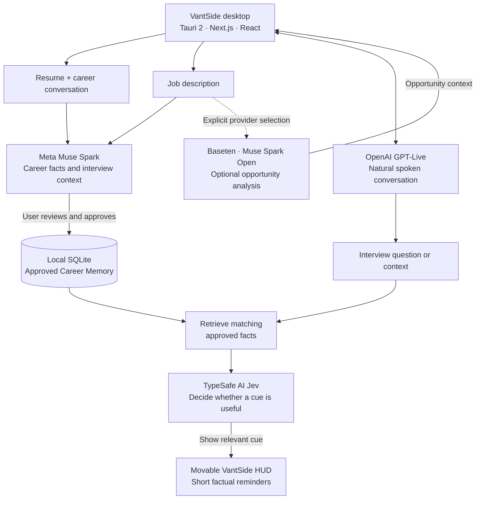

# VantSide

**Your experience, when you need it.**

VantSide turns your professional experience into a living **Career Memory**. It draws on your resume and conversations, lets you approve the facts it remembers, and connects those facts to a job opportunity. During an interview, a discreet heads-up display (HUD) can surface brief, relevant reminders—so you can tell your story in your own words.

Created for the **Meta Global AI Developer Hackathon (October 26–November 4, 2026)**.

## How it works

1. **Your Resume** — Upload a PDF and review the proposed professional facts.
2. **Let's Talk** — Discuss projects, decisions, and outcomes to deepen your Career Memory.
3. **The Opportunity** — Add a job description to connect your experience with the role.
4. **Your Interview** — Receive concise, source-grounded cues in a movable desktop HUD.

Career Memory is cumulative across opportunities. New facts require approval; job-specific information remains separate from your underlying career history.

## Architecture



## Technology

| Technology | What it does |
| --- | --- |
| **Meta Muse Spark** | Analyzes resumes, identifies career facts, and supports interview and opportunity understanding. |
| **Meta Muse Voice Transcribe** | Transcribes recorded answers in the existing turn-based voice flow. |
| **Baseten / Muse Spark Open** | Provides an explicitly selected inference route for pasted job descriptions. |
| **OpenAI GPT-Live** | Powers natural, low-latency spoken conversations. |
| **TypeSafe AI Jev** | Makes fast, structured decisions about when a Career Memory cue belongs in the HUD. |
| **Tauri 2 · Next.js · React · TypeScript** | Delivers the cross-platform desktop interface and HUD. |
| **SQLite** | Stores approved Career Memory locally between sessions. |

The AI services have distinct jobs: **understand experience, converse naturally, and decide when a reminder is relevant**. Jev does not invent facts or generate interview answers; the HUD only draws from approved memories.

## Run locally

Requires **Node.js 20.9+** and the [Tauri 2 prerequisites](https://v2.tauri.app/start/prerequisites/).

Copy `.env.example` to `.env.local` and configure the provider credentials relevant to your setup. Never commit `.env.local`.

```powershell
npm install
npm run backend:dev
```

In a second terminal:

```powershell
npm run tauri -- dev
```

The development backend listens on `127.0.0.1:8787`. Desktop persistence uses the Tauri app-local SQLite database. SQLite data is **not encrypted at rest**; raw audio and full transcripts are not stored by default. Provider requests send the information needed to perform their AI tasks.

## Responsible use

VantSide is designed to support authentic recall, not to fabricate experience or answer on someone's behalf. Users review proposed Career Memory facts, and interview assistance must follow the rules and consent requirements of the setting. See [GUARDRAILS.md](GUARDRAILS.md).

## Project notes

The VantSide concept predates the hackathon; this repository is a newly authored implementation for the event. See [ARCHITECTURE.md](ARCHITECTURE.md), [PRODUCT.md](PRODUCT.md), and [DESIGN.md](DESIGN.md) for details.
